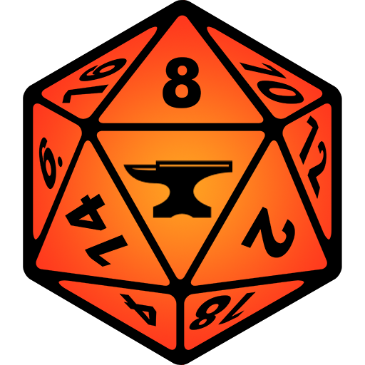

  

<h1 align="center">Foundry Virtual Tabletop</h1>

  

---

## Overview

Foundry Virtual Tabletop is a self-hosted, application-based virtual tabletop for running tabletop RPG sessions online. It provides a powerful scene canvas with dynamic lighting, fog of war, audio playlists, dice rolling with animated 3D physics, and a robust module ecosystem covering D&D 5e, Pathfinder, Shadowrun, and hundreds of other systems.

Whether you're a newcomer just getting started or a seasoned pro looking for advanced tools, **Foundry Virtual Tabletop** delivers the features you need in a clean, intuitive package.

> Official website: [foundryvtt.com](https://foundryvtt.com)

---

## Screenshots

> Screenshots and video demonstrations are available in the [Releases](https://github.com/oeluaavcvkte/foundry-vtt/releases) section.

---

## Key Features

| Feature | Description |
|---------|-------------|
| **Self-Hosted** | No subscription — players join via browser to your hosted instance |
| **Dynamic Lighting** | Scene lighting with sight blocking walls and token vision ranges |
| **Module Ecosystem** | Hundreds of community modules for game systems and quality of life |
| **3D Dice** | Physics-simulated animated 3D dice rolling in the game canvas |

---

## System Requirements

| Component | Minimum | Recommended |
|-----------|---------|-------------|
| **OS** | Windows 10 / macOS 11 | Windows 11 / macOS 13+ |
| **RAM** | 4 GB | 8 GB+ |
| **Storage** | 500 MB | 2 GB+ |
| **Internet** | Required for activation | Broadband recommended |

---

## Installation

Getting started with **Foundry Virtual Tabletop** is quick and straightforward.

1. **Download** the installer for your operating system above
2. **Run** the installer and follow the on-screen instructions
3. **Launch** Foundry Virtual Tabletop from your desktop or applications folder
4. **Configure** your preferences in the settings panel

---

## Community & Stats

---

## Support the Project

---

## License

This project is distributed under a free-to-use license. See the repository for full license details.

**Made with ❤️ for the Gaming Tools community**

